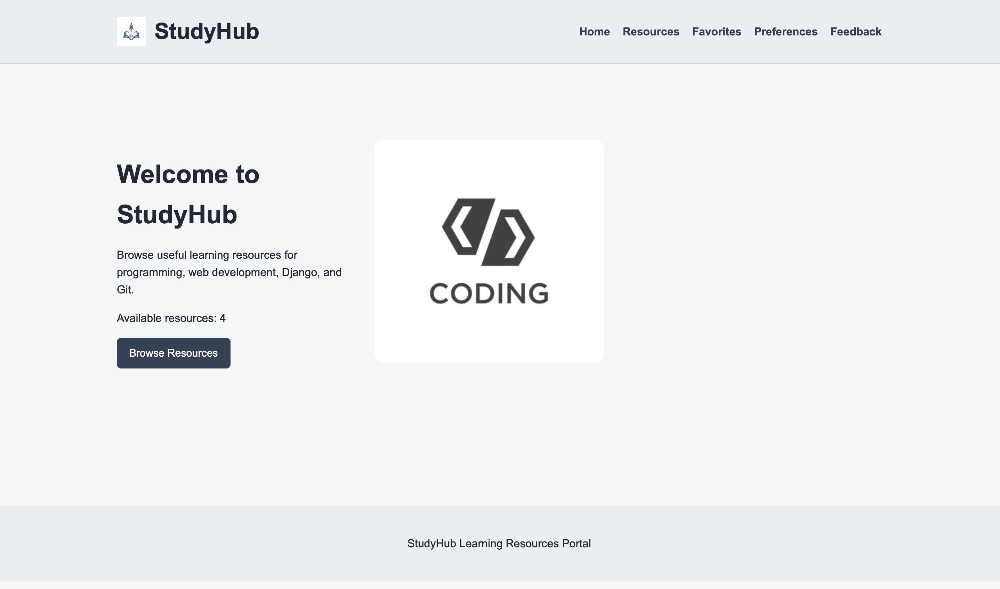
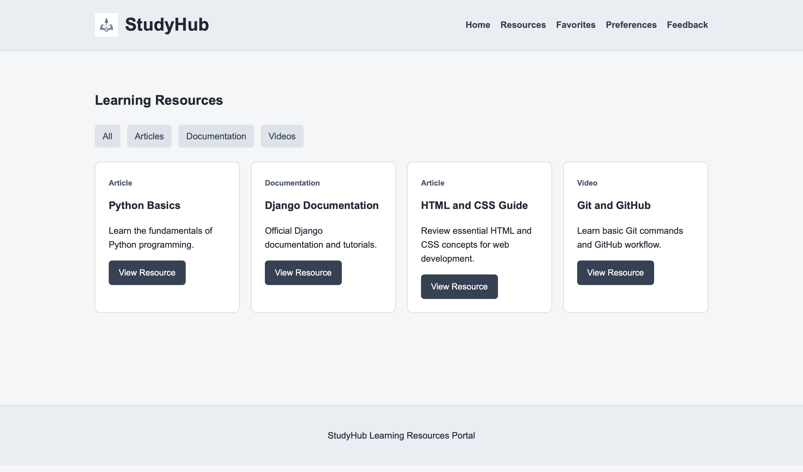
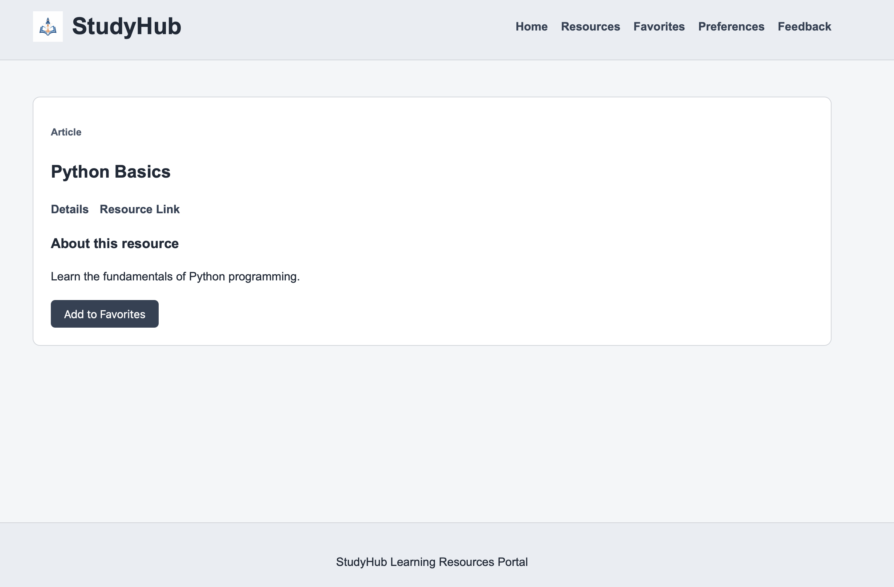
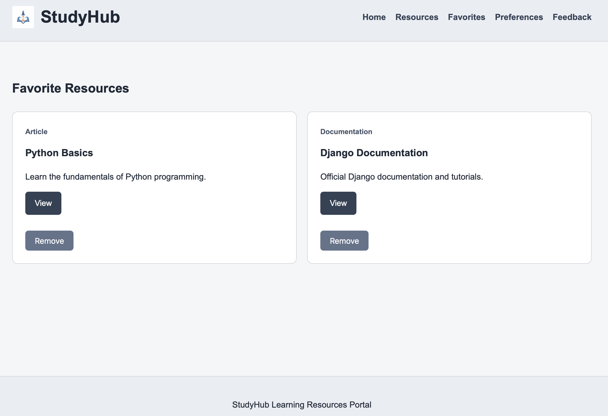
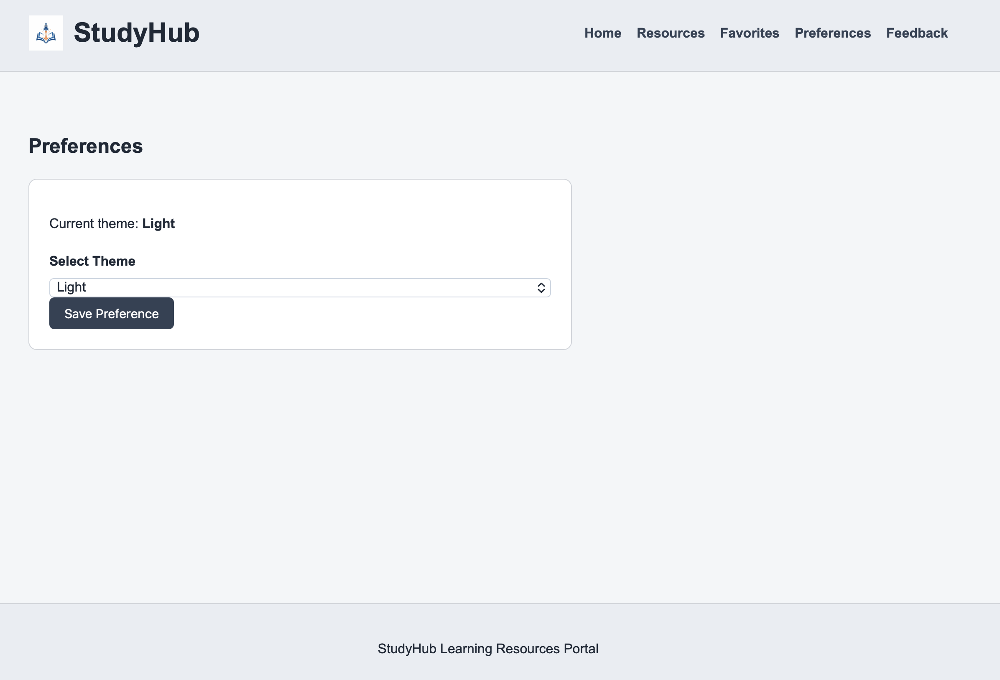
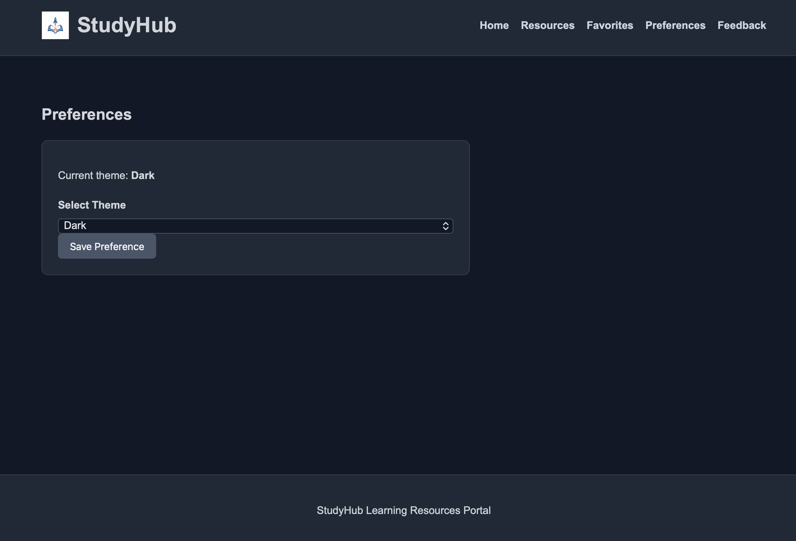
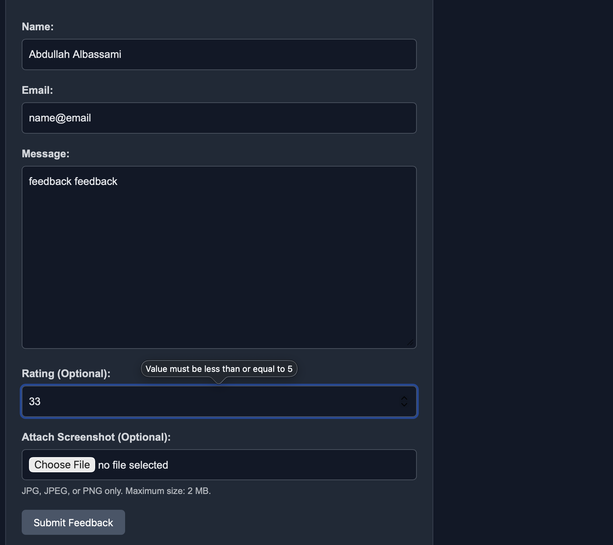
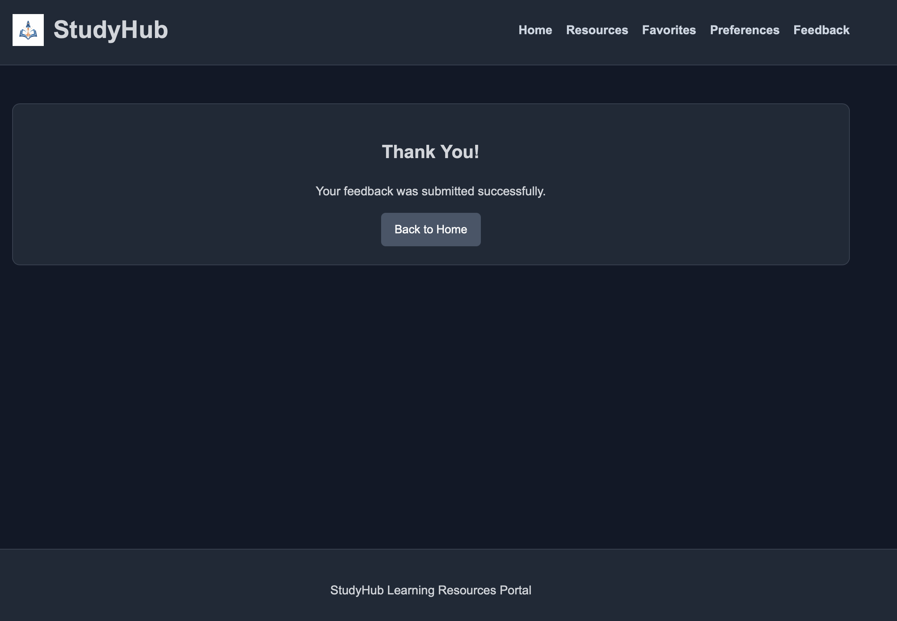

# StudyHub

StudyHub is a learning resources portal built with Django. It allows users to explore educational resources, save favorites, customize their theme, and submit feedback with optional screenshot attachments.

The project demonstrates Django fundamentals, including URL routing, views, templates, static and media files, forms, cookies, sessions, and request handling.

## Features

- Browse educational resources, including articles, videos, and documentation.
- View individual resource details and access external learning materials.
- Filter resources using query parameters.
- Add and remove favorite resources.
- Switch between light and dark themes.
- Submit feedback with form validation.
- Optionally attach screenshots to feedback.
- Display confirmation messages and handle invalid resource IDs.

## Technologies

- Python
- Django 6.1.1
- HTML and CSS
- Pillow
- JSON

SQLite is used for Django's built-in session management. Learning resources are stored in a Python list, and feedback submissions are stored in a JSON file.

## Setup

### 1. Create and activate a virtual environment

```bash
python3 -m venv venv
source venv/bin/activate
```

### 2. Install dependencies

```bash
pip install -r requirements.txt
```

### 3. Apply migrations

```bash
python manage.py migrate
```

### 4. Start the development server

```bash
python manage.py runserver
```

Open the application at:

http://127.0.0.1:8000/

## Project Structure

```text
AbdullahAlbassami-Unit4/
└── studyhub_project/
    ├── manage.py
    ├── requirements.txt
    ├── .gitignore
    ├── studyhub_project/
    │   ├── settings.py
    │   ├── urls.py
    │   ├── asgi.py
    │   └── wsgi.py
    ├── core/
    │   ├── views.py
    │   ├── urls.py
    │   ├── forms.py
    │   └── templates/
    │       └── core/
    │           ├── home.html
    │           ├── resource_list.html
    │           ├── resource_detail.html
    │           ├── favorites.html
    │           ├── preferences.html
    │           ├── feedback.html
    │           └── feedback_thanks.html
    ├── templates/
    │   └── base.html
    ├── static/
    │   ├── css/
    │   │   ├── base.css
    │   │   ├── light.css
    │   │   └── dark.css
    │   └── images/
    │       ├── logo.png
    │       └── sample_resource.jpg
    ├── media/
    │   └── feedback/
    └── data/
        └── feedback.json
```

The `media/` directory and `feedback.json` are generated or populated during use and are excluded from Git.

## URLs and Views

| URL | Description |
|-----|-------------|
| `/` | Home page |
| `/resources/` | Browse learning resources |
| `/resources/<int:id>/` | View a specific resource |
| `/favorites/` | View favorite resources |
| `/favorites/add/<int:id>/` | Add a resource to favorites |
| `/favorites/remove/<int:id>/` | Remove a resource from favorites |
| `/preferences/` | Manage theme preferences |
| `/feedback/` | Submit feedback |
| `/feedback/thanks/` | Feedback confirmation page |

The application uses named URL patterns and app-level routing through `core/urls.py`.

Path parameters identify individual resources, while query parameters control resource filtering and detail-page content.

## Templates and Static Files

The application uses Django template inheritance through `base.html`, providing a shared header, navigation, main content area, and footer.

Static files include the StudyHub logo, a learning resource image, and separate CSS files for the base layout and light/dark themes.

Static assets are referenced using Django's `` template tag.

## Cookies and Sessions

### Theme Preferences

The selected light or dark theme is stored in a browser cookie for 30 days.

The application reads the cookie on each request and defaults to the light theme when the cookie is missing or invalid.

### Favorites

Favorite resource IDs are stored in Django sessions.

Users can add and remove favorites, and duplicate favorite IDs are prevented.

Favorites remain available between requests within the same session.

## Feedback Form

The feedback form is implemented using Django's `forms.Form`.

It includes:

- Name: Required, with custom validation.
- Email: Required, with email format validation.
- Message: Required, with a minimum length of 10 characters.
- Rating: Optional, from 1 to 5.
- Screenshot: Optional, accepting JPEG and PNG images up to 2 MB.

The form uses CSRF protection, field validation, and `cleaned_data`.

After successful submission, the user is redirected to a separate Thank You page using the Post/Redirect/Get pattern.

### Feedback Storage

Valid feedback submissions are saved in:

`data/feedback.json`

Each entry includes the submitted information, optional screenshot path, and submission timestamp.

The feedback file is excluded from Git to prevent personal information from being committed.

## Media Files

Uploaded feedback screenshots are validated using Django and Pillow.

Accepted images are stored in:

`media/feedback/`

The relative image path is recorded alongside the corresponding feedback submission in `feedback.json`.

Uploaded media files are excluded from Git.

## Error Handling

- Invalid resource IDs return an HTTP 404 response.
- Invalid form submissions display field-specific validation errors.
- Unsupported or oversized image uploads are rejected.
- Invalid theme cookie values default to the light theme.
- Duplicate favorite IDs are prevented.


## Screenshots

### Home Page


### Resource List


### Resource Detail


### Favorites


### Light and Dark Themes




### Feedback Validation


### Feedback Success


## Known Limitations

- Learning resources are stored in a Python list rather than a database.
- Favorites are session-based and are not associated with registered user accounts.
- Feedback is stored in a JSON file rather than a database.
- There is no user registration or login system.
- The application is intended for local development and learning, not production deployment.

## Future Improvements

- Store learning resources and feedback using Django database models.
- Add user registration, login, and logout.
- Associate favorites with individual user accounts.
- Add an administrative interface for managing learning resources and feedback.
- Improve image management and feedback storage for production use.
- Add search and additional resource filtering options.